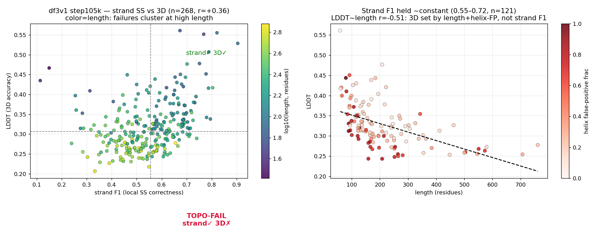
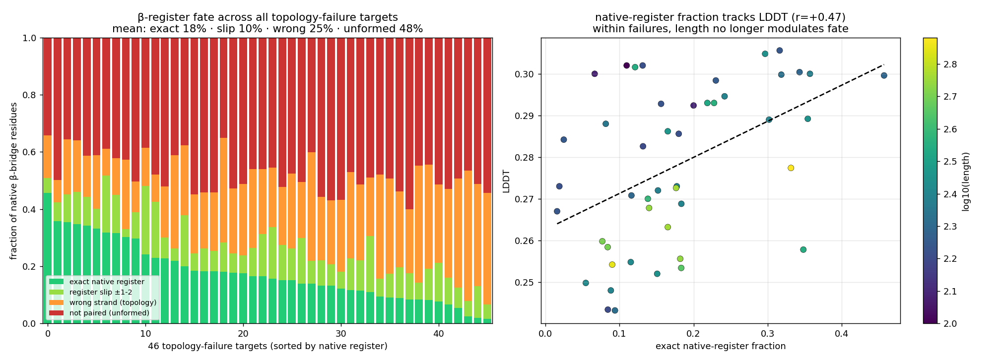
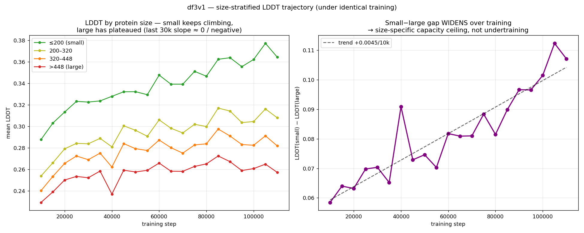
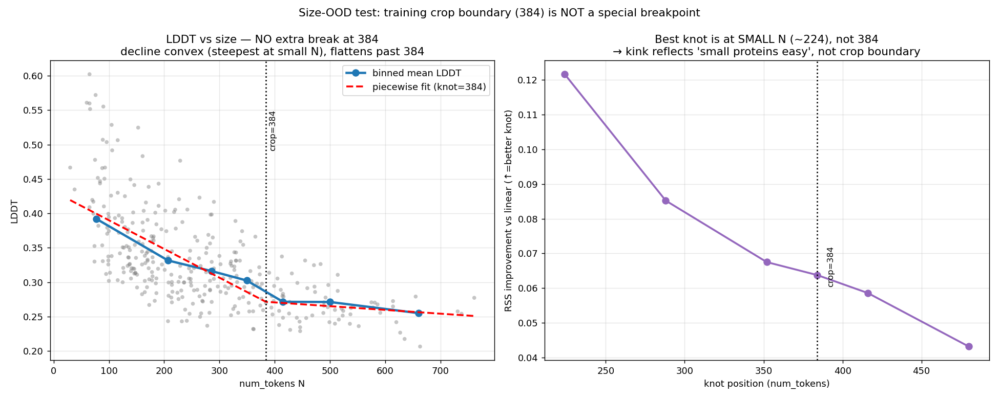

# df3v1: long proteins weren't being learned — a size-scaling capacity ceiling

*FoldBench-small monomer analysis, df3v1 (run `df3-25e5-c10-g35`, the **nofape**
arm), steps 10k–110k. Confidence head OFF (`alpha_confidence=0`) → LDDT/TM only;
df3v1 is mid-training, so the **trajectory** is the signal, not absolute LDDT.*

---

## TL;DR

**Small proteins keep improving; large proteins plateaued early at LDDT ~0.26 and
the gap between them widens over training.** Under one identical schedule, the
slowdown is *size-specific* — so it is **not** a step-count / "needs more
training" problem but a **capacity ceiling that scales with protein size**.

The failure is concretely a **β-sheet that doesn't close**: the model gets each
residue's local secondary structure right but pairs the strands to the wrong
partner, or to no partner at all. This is non-local geometry, and the structure
module's global-registration capacity runs out as the pair graph grows.

We ruled out, in turn: rel-pos clipping, MSA depth, a crop-boundary OOD cliff,
and inference-time recycling. **Action: raise the training crop (AF3-style ramp,
384→640), `configs/stage1_crop640.yaml`.** The crop-768 retrain is also the one
clean experiment that separates "capacity" from "large folds are just intrinsically
harder".

---

## 1. Symptom — local SS correct, 3D wrong, and the failures are *long*

Getting secondary structure right does **not** get 3D right. Per-target, strand
F1 ↔ LDDT correlation ≈ **0** (helix-FP is even negatively related). The targets
where the model nails strand SS but still misfolds ("topology failures") cluster
in the bottom-right, and they are the **long** proteins (color = length).

*Left: strand F1 × LDDT, colored by length — failures (strand✓ 3D✗) are long.
Right: holding strand F1 fixed (0.55–0.72), LDDT is set by length (r=−0.51) and
helix false-positives, not by the strand F1 itself.*

The strongest per-target 3D predictor is `macro_8` (LDDT r=+0.67, robust to
length), and **length dominates LDDT** (r=−0.62; −0.57 with strand F1 held
fixed). Local SS is necessary, not sufficient.

## 2. Mechanism — the β-sheet doesn't close (register failure)

Using DSSP bridge partners (BP1/BP2) we trace the fate of every native β-bridge
residue. Across the 46 topology-failure targets: **48% form no partner at all
(sheet unformed)**, 25% pair to the *wrong* strand (topology scrambled), and only
~18% land in native register. The prediction forms just 69% of the native
β-pairs.

*Left: register fate across all topology-failure targets — "not paired" (sheet
unformed) dominates. Right: the native-register fraction tracks LDDT (r=+0.47);
within failures, length no longer modulates the fate.*

This is the same "the model hedges on β" bias seen at the residue level
(strand→coil omission). At the **length-scale** level, the prediction is faithful
only up to a single secondary-structure element (~8 residues, dRMSD ~2 Å) and
collapses past the sheet-pairing scale (16–48 residues). The resulting
**coherence length** (separation where distance error first exceeds 3 Å) has a
median of just **5 residues ≈ 1 SSE**, and predicts LDDT as strongly as
`macro_8` (corr(log L, LDDT) = **+0.67**).

## 3. The headline — large proteins plateaued; the gap widens

Stratifying the LDDT trajectory by protein size (under one identical training
schedule):

| size | recent-30k LDDT slope | total gain 10k→110k |
|---|---|---|
| ≤200 res (small) | **+0.0058 / 10k (still climbing)** | +0.077 |
| >448 res (large) | **−0.003 / 10k (plateaued)** | +0.028 |

*Left: small proteins keep climbing; large ones flat-line in the last 30k. Right:
the small−large LDDT gap widens 0.058 → 0.107 over training.*

A global LR decay or pure under-training would slow **both** bins equally. Instead
small keeps rising while large stalls — the slowdown is **size-specific**. Large
proteins are converging to a *bad plateau* (~0.26), not slowly climbing toward
good. (Their coherence L does creep 3.8→4.8 — not frozen, just stuck near 1 SSE.)

## 4. Diagnosis — it's capacity, not the crop edge / recycles / steps

Four candidate levers, each ruled out:

| hypothesis | test | result |
|---|---|---|
| rel-pos clip (32) caps long-range | β-pair reproduction by separation | **✗** successes close sep 64–128 at 29% (failures 4%) |
| MSA depth is the discriminator | depth ↔ LDDT | **✗** +0.07 controlling length; depth quartiles flat |
| size-OOD cliff at training crop (384) | piecewise regression | **✗** no extra break at 384 (best knot ~224; slope *flattens* past 384) |
| inference recycling too shallow | recycle 10→20 A/B (seed fixed) | **✗** large-protein RMSD stays 20–30 Å |
| just more training steps | size-stratified trajectory | **✗** large plateaued, gap widens (§3) |

*The training-crop boundary (384) is not a special breakpoint — the LDDT decline
with size is smooth and convex. So the failure is a **continuous** size-scaling
ceiling, not a context-window cliff.*

The discriminator is **N (total size), not sequence separation**: the same sep-32
β-pair is closed 26% of the time in a small protein, 7% in a large one. The
structure module (triangle updates + recycling) globally registers a small pair
graph but only satisfies local patches of a large one.

## 5. Action

Inference knobs (recycling) and step count are ruled out → the lever is
**training-time capacity**. The standard, immediately available move is to **grow
the training crop** so the trunk practices global registration on larger pair
graphs (AF3 staged-crop ramp).

- **Stage 1:** `configs/stage1_crop640.yaml` — crop 384→640, bond loss ON,
  smooth_lddt OFF, Schedule-Free optimizer kept, FAPE off (nofape lineage).
  Resume df3v1 105k with `--params`.
- **Next:** `finetune2_structure_768` (crop 768). The crop-768 retrain is also the
  **definitive test**: if large proteins lift after the ramp → capacity ceiling
  confirmed; if not → the bottleneck is trunk capacity / training-recycle depth,
  not the crop.

**Honest caveat:** because there was *no* sharp cliff at the 384 crop boundary
(§4), raising the crop is a well-motivated *capacity bet*, not a lever the data
singled out. A gradual crop effect for N>384 stays confounded with intrinsic
fold difficulty until the crop-768 A/B runs.

---

### Reproducibility

Per-target metrics + figures live under `bench/runs/df3v1/ss_analysis/`
(`*_monomer_protein.png`, `beta_register_topofail.csv`). Analysis scripts
(β-register via DSSP bridge partners, dRMSD coherence length, size-stratified
trajectory, piecewise size-OOD) were session scratchpad one-offs; the methods are
specified in the `reference_coherence_length_method` memory for re-implementation.
df3v1 trains at `max_recycles=3` (relevant to why the inference recycle-20 test
was a no-op — the trunk saturates well before 10, let alone 20).
