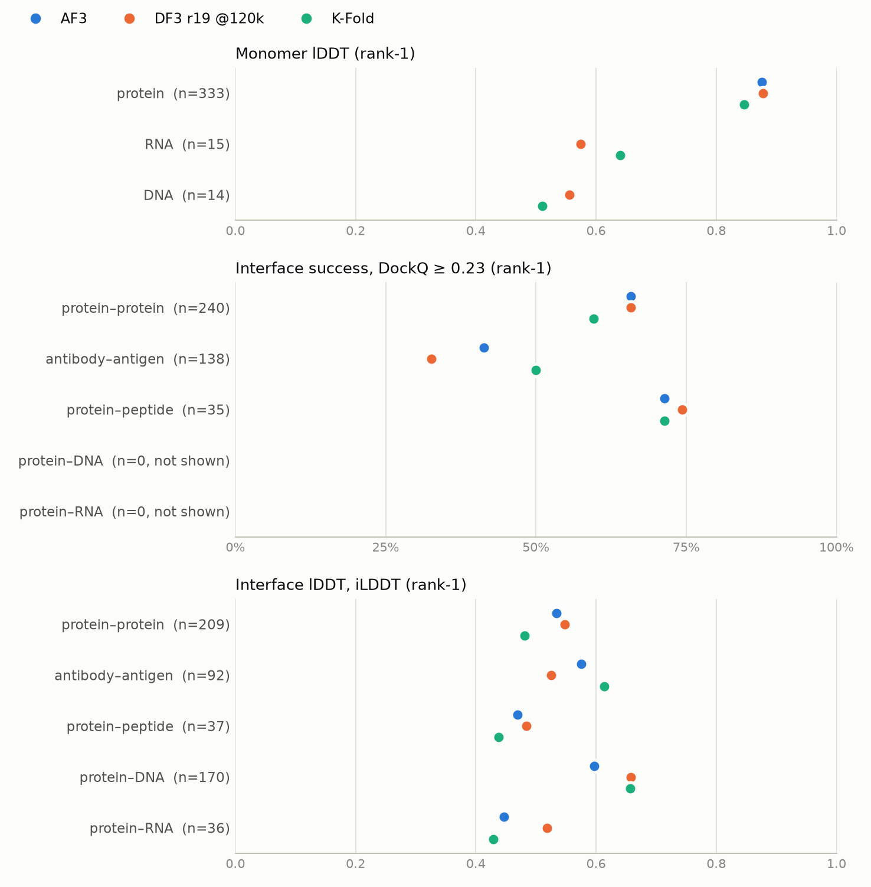

# K-Fold on FoldBench-small

*2026-09-10. [K-Fold](https://github.com/SeonghwanSeo/kfold) folded through the bench harness
and compared per category against AlphaFold 3 and DeepFold3 r19 at step 120k (`df3v5r19s1`).*

K-Fold is MSA-free. It runs in two stages, both part of its own CLI: `kfold prepare` folds
every protein chain from sequence alone with **AtlasFold** (a protein-language-model folder,
AtlasLM-3B + an AF3-style trunk and diffusion head) to build an "apo" ensemble, and
`kfold predict` runs the K-Fold network itself, which tokenizes those apo structures and
diffuses apo → holo to assemble the complex. `predict` refuses to run without apo
structures. AtlasFold therefore plays the role MSAs and templates play in AF3 / DF3 — it is
the information source, not a substitute model.

## Setup

| | |
|---|---|
| Model | K-Fold `28c46bc` (2026-09-09); weights HF `SeonghwanSeo/kfold@16d9adbf`, `SeonghwanSeo/kfold-assets@8b5cf269` |
| Apo generator | AtlasFold `atlasfold-260703@d6e6193b` on AtlasLM `atlaslm-3b-base@109c9290` (`atlasfold` 1.0.0) |
| Stack | torch 2.14.0 + cu130, cuEquivariance 0.11.1, 8× B200; OST 2.8.0 |
| Targets | FoldBench-small: the `in_small` rows of `bench/inputs/<category>_manifest.csv` (≤ 1024 tokens) — the set `run_sweep.py` folds for every df3 series |
| Apo ensemble | AtlasFold seeds 1–5 × 5 samples per unique protein sequence → 5 apo (best per seed) + 25 prior structures, the K-Fold README example |
| Prediction | `kfold predict` defaults — ≤ 3 apo, 10 recycles, 100 diffusion steps, 5 samples per seed. Seeds 42–45 on protein–protein and antibody–antigen, 42–43 elsewhere: the `auto.sh` budget r19 was benched at |
| Sample budget | N-matched per category: every model is cut to the seeds all of them folded — 42–45 × 5 = 20 samples on protein–protein and antibody–antigen, 42–43 × 5 = 10 elsewhere. AF3 was folded with 42–45 everywhere, so its extra seeds are dropped on the other six categories (oracle is monotone in N) |
| Not matched | diffusion steps — K-Fold 100 (its default), DF3 and AF3 200; recycles are 10 for all three. Information source — MSA (+ templates) for DF3 / AF3, AtlasFold apo ensembles for K-Fold |
| Scoring | `bench/scripts/eval_ost.py` (unchanged flags); rank-1 = the `complex.ranking_score` top sample, meaned over ties |
| AF3 | measured through this bench: `af3_ref_tmpl` (with templates) on protein–protein / antibody–antigen / protein–peptide, `af3_ref` (template-free, †) elsewhere; none on the nucleic monomers, whose `af3_ref` inputs predate the water fix |

## Results



Rank-1 on the common target set of each row, seed-matched. † AF3 is the template-free
`af3_ref`. Full table (mean / oracle / TM / GDT / DockQ and the paper column):
[`kfold_foldbench/compare_by_category.md`](kfold_foldbench/compare_by_category.md).

| category | n | rank-1 metric | AF3 | DF3 r19 @120k | K-Fold |
|---|---:|---|---:|---:|---:|
| protein monomer † | 333 | lDDT | 0.875 | **0.878** | 0.846 |
| RNA monomer | 15 | lDDT | — | 0.574 | **0.640** |
| DNA monomer | 14 | lDDT | — | **0.556** | 0.510 |
| protein–protein | 240 | DockQ ≥ 0.23 | **65.8%** | **65.8%** | 59.6% |
| antibody–antigen | 138 | DockQ ≥ 0.23 | 41.3% | 32.6% | **50.0%** |
| protein–peptide | 35 | DockQ ≥ 0.23 | 71.4% | **74.3%** | 71.4% |
| protein–DNA † | 170 | iLDDT | 0.597 | **0.658** | 0.657 |
| protein–RNA † | 36 | iLDDT | 0.447 | **0.519** | 0.429 |

Against DF3 r19 @120k, K-Fold trails on protein monomers (−0.032 lDDT), DNA monomers
(−0.046), protein–protein (−6.2 pts), protein–peptide (−2.9 pts, one interface) and
protein–RNA (−0.090 iLDDT); it is level on protein–DNA (−0.001 iLDDT) and leads on RNA
monomers (+0.066 lDDT) and antibody–antigen (+17.4 pts; +8.7 over AF3).

### The gap follows AtlasFold's confidence

Splitting each category by the AtlasFold pLDDT of the target's least-confident protein chain
([`kfold_foldbench/compare_by_apo_plddt.md`](kfold_foldbench/compare_by_apo_plddt.md)):

| category | AtlasFold pLDDT | n | AF3 | DF3 r19 @120k | K-Fold |
|---|---|---:|---:|---:|---:|
| protein monomer (lDDT) | ≥ 85 | 279 | 0.890 | 0.891 | 0.885 |
| | 70–85 | 40 | 0.818 | 0.819 | 0.713 |
| | < 70 | 14 | 0.758 | 0.793 | 0.458 |
| protein–protein (success) | ≥ 85 | 190 | 68.9% | 66.8% | 64.2% |
| | < 85 | 50 | 54.0% | 62.0% | 42.0% |
| antibody–antigen (success) | ≥ 85 | 85 | 42.4% | 40.0% | 58.8% |
| | < 85 | 53 | 39.6% | 20.8% | 35.8% |

Where AtlasFold folded every chain confidently, K-Fold is level with DF3 and AF3 on protein
monomers (0.885 vs 0.891 / 0.890) and 2.6 / 4.7 pts behind them on protein–protein. The 54
monomers AtlasFold is unsure of (pLDDT < 85) carry 84% of K-Fold's monomer deficit to DF3.
Antibody–antigen runs the other way: the lead is largest on confidently folded chains
(+18.8 pts over DF3, +16.4 over AF3), so it does not come from building the chains better.

### Controls: release date and K-Fold's validation overlap

RCSB initial release dates (`export/kfold-foldbench/foldbench_small_release_dates.csv`; 903 of
904 PDB entries, 8PNI has none) put **no FoldBench-small target in any category on or before
2022-12-31** — the earliest is 2023-01-18. Cutting at the later of K-Fold's two stated training
cutoffs therefore leaves every table above unchanged (`--after 2022-12-31` drops only the
undated 8PNI interface). The stricter cut also removes 2023, the docstring's validation year:

| released ≥ 2024-01-01, rank-1 | n | AF3 | DF3 r19 @120k | K-Fold |
|---|---:|---:|---:|---:|
| protein monomer † (lDDT) | 158 | 0.878 | **0.883** | 0.852 |
| protein–protein (DockQ ≥ 0.23) | 109 | **63.3%** | **63.3%** | 56.9% |
| antibody–antigen (DockQ ≥ 0.23) | 63 | 34.9% | 30.2% | **49.2%** |
| protein–peptide (DockQ ≥ 0.23) | 21 | **81.0%** | 76.2% | 61.9% |
| protein–DNA † (iLDDT) | 88 | 0.651 | **0.683** | 0.663 |

RNA monomers, DNA monomers and protein–RNA keep only 8 / 4 / 15 targets after 2023.

| antibody–antigen, rank-1 success | n | AF3 | DF3 r19 @120k | K-Fold |
|---|---:|---:|---:|---:|
| all targets | 138 | 41.3% | 32.6% | 50.0% |
| released after 2023-06-01 (FoldBench's dates) | 107 | 40.2% | 32.7% | 49.5% |
| without K-Fold's 2023 validation entries (`v261230`) | 118 | 39.0% | 30.5% | 49.2% |
| released ≥ 2024-01-01 (RCSB dates) | 63 | 34.9% | 30.2% | 49.2% |

The antibody–antigen lead holds under every control — 16.8–19.0 pts over DF3, 8.7–14.3 over
AF3 — with K-Fold's own rate fixed at 49.2–50.0% while AF3's falls on the later targets. The
protein–protein deficit is as stable (−6.2 pts on all targets, −6.4 on ≥ 2024; −4.0 without
`v261230`). Commands: `compare_series.py --dates export/kfold-foldbench/foldbench_small_release_dates.csv
--after 2023-12-31`, `--after 2023-06-01`, and
`--exclude-ids references/kfold/assets/splits/v261230/validation_ids.txt`.

### Training cutoff, from the K-Fold source

- The split code (`SPLITS` in `scripts/process/rcsb/b_extract_all_sequence.py` and
  `c_process_cifs.py:109`) trains on ≤ 2021-09-30, validates on 2021-10-01 – 2023-01-12. The
  docstring and `--help` of `c_process_cifs.py` say otherwise: train ≤ 2022-12-31, val 2023,
  test 2024-01-01 – 2026-01-09.
- The shipped validation lists settle which regime the release follows only by inference:
  `assets/splits/v251213/validation_ids.txt` spans 2021-10-06 – 2023-01-11 (the code), while
  `v261230/validation_ids.txt` spans 2023-01-04 – 2023-12-27 (the docstring). No config ties
  the released weights (`kfold-260720`) to either.
- Every FoldBench-small entry RCSB dates (903 / 904) was released 2023-01-18 – 2024-10-30,
  after both training cutoffs. **194 of them are in `v261230`'s validation list** (including 15 in
  antibody–antigen, 38 in protein–protein, 50 in protein–DNA) — not trained on, but available
  for checkpoint selection. The exclusion control above removes them.
- Not stated anywhere in the code: the distillation sets, and the AtlasFold / AtlasLM cutoffs.

## Caveats

- **Antibodies are folded chain by chain.** Every protein chain is a plain `sequences` entry,
  so AtlasFold folds heavy and light chains separately. K-Fold also accepts an H:L pair as
  `multimer_sequences` (AtlasFold-M) and trained on SAbDab pairs that way; the bench inputs
  carry no H/L typing, so that mode was not used. Antibody–antigen is a lower bound for it.
- **28 protein–DNA inputs repeat a chain id.** `build_inputs.py` names protein chains after
  the a3m files and nucleic chains after the ground-truth CIF, and the two namespaces collide
  (8e3r: protein `C`, DNA `C` and `D`). K-Fold rejects a repeated id, so
  `kfold_bench.py:unique_chain_ids` re-letters it. df3 re-letters chains on write and OST maps
  model chains to the reference by content, so scores are unaffected; the collision itself
  lives in `build_inputs.py`.
- **`bench/inputs/interface_protein_protein/` holds 17 stale over-cap JSONs** (1058–1508
  tokens, 2026-06-30). `build_inputs.py` never deletes one; targets come from the manifest.
- **Nucleic-interface DockQ is nearly empty for every model** — OST's DockQ returns 4
  protein–DNA and 0 protein–RNA interfaces at r19 @120k. Those categories are read from iLDDT
  and whole-model lDDT; DockQ rows with fewer than 10 common interfaces are dropped.
- Non-standard residues: protein → `X`, nucleic → `N` (K-Fold validates its alphabets).

## Reproduce

```bash
# once: cd references/kfold && uv venv .venv --python 3.11 && uv pip install --python .venv/bin/python -e '.[cuequiv]'
PROCS_PER_GPU=2 bash bench/scripts/kfold_run.sh        # prepare -> queries -> predict -> tree -> OST -> compare
.venv/bin/python bench/scripts/compare_series.py --df3-series df3v5r19s1 --df3-step 120000
```

`kfold_run.sh` is resumable at every stage. `kfold_bench.py` holds the input conversion and the
output → bench-tree mapping; `compare_series.py` the per-category aggregation.

## Artifacts (on disk, not in git)

| path | contents |
|---|---|
| `bench/runs/archives/kfold_foldbench.tar.zst` (1.33 GiB) | K-Fold predictions (12,230 `model.cif`, symlinks resolved), per-sample confidence JSONs, OST `eval/`, the 904 K-Fold queries, the AtlasFold apo/prior ensembles (27,125 PDB), logs, `export/kfold-foldbench/` |
| `bench/runs/archives/df3v5r19s1_step120000_foldbench.tar.zst` (1.11 GiB) | DF3 r19 @120k predictions (12,230 `model.cif` + confidences; per-seed trunk distograms left out), OST `eval/`, and the FoldBench-compare figures at 120k |
| `export/kfold-foldbench/` | `compare_by_category.*`, `compare_by_apo_plddt.*`, and the `post2023-06-01/` and `excl_v261230/` controls |
| `export/foldbench-compare/out/df3v5r19s1_step120000/` | the FoldBench-compare report pinned at r19 120k. `_run.py` now writes a pinned `--step` to `out/<run>_step<N>/` so `auto.sh`'s latest-step refresh cannot overwrite it (that change lives under the untracked `export/`) |
