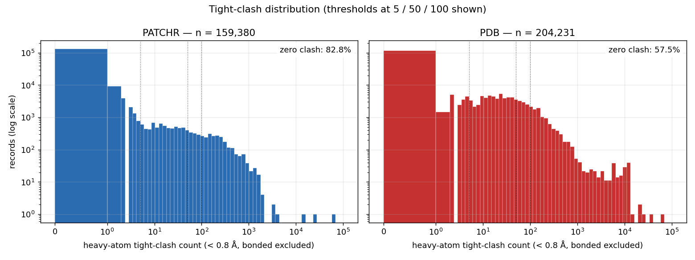
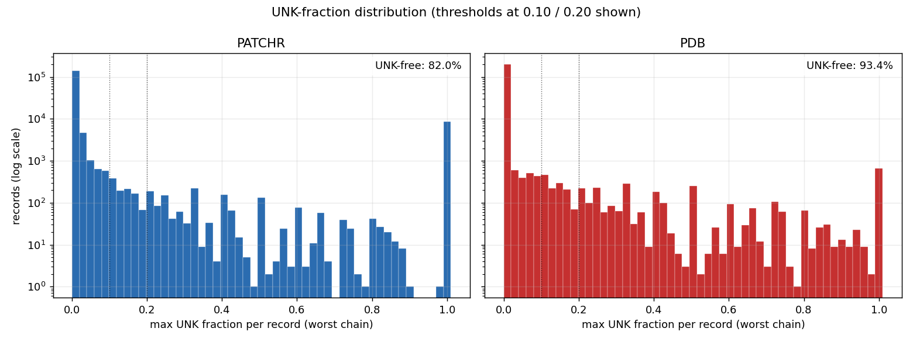
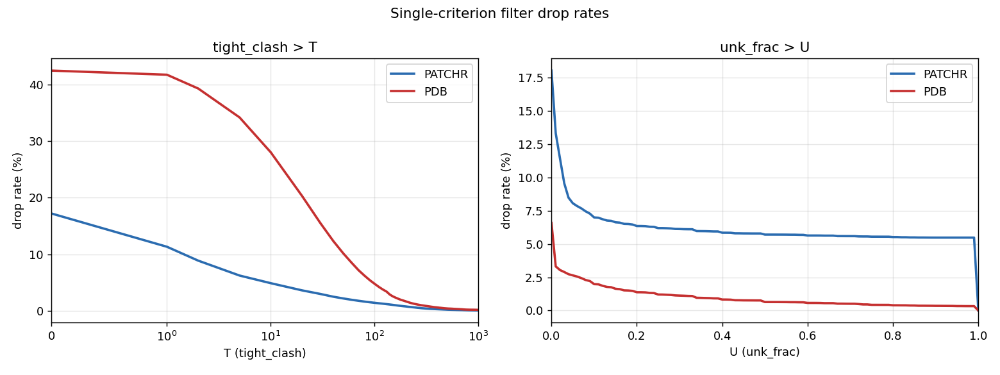
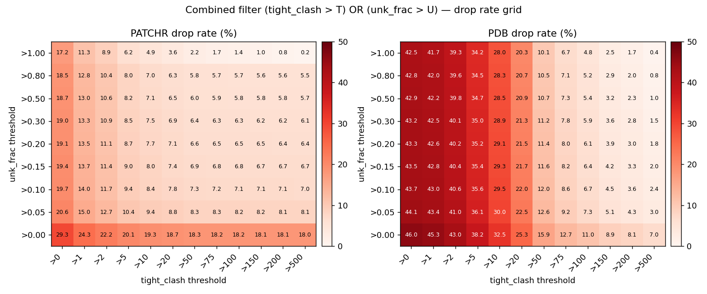
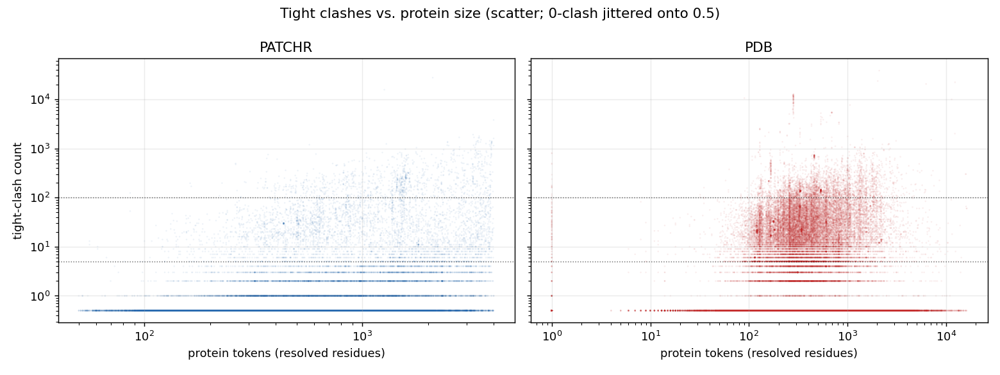

# PATCHR dataset quality investigation

**Scope.** Full audit of `/data/distillation/patchr_training` (159,380
records in `manifest.json`; ~134k survive sampler validity checks) to
quantify the extent of (a) sub-angstrom heavy-atom clashes and (b)
UNK-residue content, and to evaluate how many of the records that
appeared in NaN/Inf training-loss windows are caught by the new
`--max-tight-clashes` + `--max-unk-fraction` filters.

**Artifacts.**

- Manifest backup: `manifest.json.pre_filter_backup.20260419_035359`
  (same dir, byte-identical copy; `cp -n` so any re-run is a no-op).
- Per-record audit CSV: `/tmp/patchr_audit.csv` (159,380 rows).
- Explosion record scan: `/tmp/explosion_scan.json` (all record_ids
  pulled from inf-grad windows in `runs/test/*`).

## 1. Training runs surveyed

| run               | total opt-step skips | ranks that skipped           |            logged record-id windows |
| ----------------- | -------------------: | ---------------------------- | ----------------------------------: |
| `20260418_165948` |                    9 | 1,2,3,5,6                    | 0 (per-rank logging not yet landed) |
| `20260418_215850` |                   47 | 2,4,6,7                      |                                 104 |
| `20260419_012532` |                    4 | 0,3,5,7                      |                                   4 |
| `20260419_022307` |                    4 | 0,1,3,6                      |                                   4 |
| **total**         |               **64** | all 8 ranks seen across runs |                             **112** |

All 64 skips were grad-side (non-finite after backward); 0 loss-side.
Ranks 0–7 all appear across runs — no GPU is systematically flaky.

**Unique records pulled from the 112 logged windows (32 records per
window):**

- PATCHR: **1,755**
- long_monomers (OF3 distillation): 1,587
- short_monomers (OF3 distillation): 190
- total unique ids: 3,532 across 3,584 id-slots (≈ all distinct)

Each 32-record window contains many non-culprits, but the distribution
of an enriching property (clash, UNK, size) in this set vs. the full
manifest tells us whether the filter is hitting the right tail.

## 2. Full PATCHR distribution (n = 159,380)







### Heavy-atom clash count (pairs closer than 0.8 Å, bonded excluded)

| tight-clash bucket | records |  share |
| ------------------ | ------: | -----: |
| 0                  | 131,982 | 82.81% |
| 1                  |   9,364 |  5.88% |
| 2–5                |   8,105 |  5.09% |
| 6–10               |   2,157 |  1.35% |
| 11–50              |   4,305 |  2.70% |
| 51–100             |   1,225 |  0.77% |
| 101–500            |   1,929 |  1.21% |
| > 500              |     313 |  0.20% |

- **Most PATCHR structures are clean.** 82.8% have zero sub-0.8 Å
  non-bonded heavy-atom pairs.
- **Long pathological tail.** 313 records have > 500 overlapping atom
  pairs. The extreme outlier `8qph` has **59,673** tight clashes
  (13 chains, 3,237 protein tokens, no UNK) — structural corruption of
  a large assembly, not a local annotation error.
- Other top offenders (`8qfe` 27,546, `6een` 15,649, `7sbl` 3,789,
  `8dvd` 3,409) all have thousands of clashes; typical signatures are
  (i) very large cryoEM assemblies with chain-placement errors, or
  (ii) records where the entire structure is labelled UNK (`7sbl`,
  `8dvd`, `6bfu`, `8dto`, `7lxn`, …) — some of these correspond to
  low-resolution density fits where sequence assignment is ambiguous.

### UNK fraction

```
p50 = 0.00   p90 = 0.027   p95 = 1.0   p99 = 1.0
```

The distribution is bimodal: ~94% of records have <5% UNK, a long thin
region with 5–50% UNK, and a spike at 100% (records where sequence
could not be assigned to any chain). `max_unk_fraction` is computed
per chain — a record's score is the worst-affected chain.

### Size + ligand composition

```
p50 n_chains       = 2      p90 = 12     p99 = 29     max = 300
p50 ligand_chains  = 0      p90 =  7     p99 = 23     max = 277
p50 protein_tokens = ~240   p90 ≈ 1200   p99 ≈ 3700
```

## 3. Filter drop-rate on the full manifest

| criterion         | full drop rate | count dropped |
| ----------------- | -------------: | ------------: |
| tight_clash > 0   |         17.19% |        27,398 |
| tight_clash > 1   |         11.32% |        18,038 |
| tight_clash > 5   |          6.23% |         9,929 |
| tight_clash > 10  |          4.88% |         7,777 |
| tight_clash > 50  |          2.18% |         3,467 |
| tight_clash > 100 |          1.41% |         2,242 |
| unk_frac > 0.05   |          8.07% |        12,862 |
| unk_frac > 0.10   |          7.00% |        11,157 |
| unk_frac > 0.20   |          6.35% |        10,121 |
| unk_frac > 0.50   |          5.71% |         9,102 |

### Combined (tight_clash > TC) OR (unk_frac > U)

| (TC, U)       | full drop % | full drop count |
| ------------- | ----------: | --------------: |
| (0, 0.05)     |      20.58% |          32,795 |
| (0, 0.10)     |      19.66% |          31,341 |
| (0, 0.20)     |      19.13% |          30,483 |
| (**5, 0.10**) |   **9.36%** |      **14,919** |
| (5, 0.20)     |       8.74% |          13,934 |
| (10, 0.10)    |       8.38% |          13,354 |
| (10, 0.20)    |       7.75% |          12,344 |

## 4. Cross-reference: explosion set vs. full distribution

The **enrichment** column is the ratio of explosion-set drop rate to
full-manifest drop rate. A value of 1.0 means the filter catches the
explosion set no more than it catches a random PATCHR record; values

> 1 indicate the filter is targeting the population of records that
> tend to appear in inf-grad windows.

| criterion         | full % | explosion % | enrichment |
| ----------------- | -----: | ----------: | ---------: |
| tight_clash > 0   |  17.19 |   **30.03** |      1.75× |
| tight_clash > 1   |  11.32 |   **21.14** |      1.87× |
| tight_clash > 5   |   6.23 |   **11.68** |      1.88× |
| tight_clash > 10  |   4.88 |        8.66 |      1.78× |
| tight_clash > 50  |   2.18 |        3.93 |      1.81× |
| tight_clash > 100 |   1.41 |        2.79 |      1.98× |
| unk_frac > 0.05   |   8.07 |       10.66 |      1.32× |
| unk_frac > 0.10   |   7.00 |        8.83 |      1.26× |
| unk_frac > 0.20   |   6.35 |        7.69 |      1.21× |
| unk_frac > 0.50   |   5.71 |        6.84 |      1.20× |

### Combined

| (tight_clash > TC) OR (unk > U) |   full % | explosion % |    enrich |
| ------------------------------- | -------: | ----------: | --------: |
| (0, 0.05)                       |    20.58 |       33.62 |     1.63× |
| (0, 0.10)                       |    19.66 |       32.19 |     1.64× |
| (0, 0.20)                       |    19.13 |       31.45 |     1.64× |
| (**5, 0.10**)                   | **9.36** |   **14.93** | **1.59×** |
| (5, 0.20)                       |     8.74 |       13.96 |     1.60× |
| (10, 0.10)                      |     8.38 |       12.19 |     1.46× |

### Covariates that correlate strongly with the explosion set

Not filter criteria themselves, but useful context:

| property                  | full % | explosion % | enrichment |
| ------------------------- | -----: | ----------: | ---------: |
| ≥ 1 ligand chains         |  35.36 |       56.52 |      1.60× |
| **≥ 5 ligand chains**     |  12.63 |   **32.14** |  **2.54×** |
| ≥ 10 ligand chains        |   7.39 |       20.11 |      2.72× |
| ≥ 15 ligand chains        |   3.69 |        9.91 |      2.69× |
| protein tokens ≥ 1000     |  18.81 |       37.09 |      1.97× |
| **protein tokens ≥ 2000** |   5.34 |   **13.22** |  **2.48×** |
| protein tokens ≥ 3000     |   1.72 |        4.50 |      2.62× |

Ligand-heavy and large-assembly records are the strongest signal
correlated with inf-grad windows — more so than clashes alone. With
`ligand_loss_weight=10.0` in the diffusion MSE, a badly-placed ion or
glycan inside a 50-chain assembly is in effect a 10× amplifier on an
already-rough early-training target.

## 5. Interpretation

### 5.1 Per-record enrichment

- Each 32-record window is not a 32-member conspiracy; typically a
  small number of records trigger the inf. If the filter perfectly
  identified the single offender in every window, it would show a
  `31/32` = 3.1% "bonus" over the full-manifest rate, plus the base
  rate itself. Observed enrichment of ~1.6–2.0× across clash
  thresholds is consistent with the filter capturing a meaningful
  fraction of real offenders — not the whole story, but the dominant
  static component.
- The UNK filter alone has the weakest enrichment (1.2–1.3×). UNK
  residues by themselves are rarely the direct cause of non-finite
  grads — what hurts is when UNK co-occurs with high clash counts, as
  in the `7sbl` / `8dvd` / `6bfu` cluster. The tight-clash filter
  already catches those.
- The enrichment plateau near 1.6–2.0× says part of the inf-grad
  activity is data-driven (and catchable by geometry filters) and
  part is not — residual bf16 activation overflow under high-sigma
  diffusion noise at early warmup, for example, is a weights-side
  phenomenon that a data filter cannot address.

### 5.2 Per-explosion-event coverage (the meaningful metric)

The per-record enrichment above treats each record in the 1,755-id
pool equally. A stronger question: **for each actual inf-grad event
— identified by (run, opt-step) — does the filter catch at least one
dropped record inside the 32-sample window that triggered it?**

| threshold                | windows w/ ≥1 dropped record | distinct (run, step) events |
| ------------------------ | ---------------------------: | --------------------------: |
| tc > 0 OR unk > 0.10     |           **112/112** (100%) |                         8/8 |
| tc > 5 OR unk > 0.05     |              106/112 (94.6%) |                         8/8 |
| **tc > 5 OR unk > 0.10** |           **99/112** (88.4%) |                     **8/8** |
| tc > 5 OR unk > 0.20     |               96/112 (85.7%) |                         8/8 |
| tc > 10 OR unk > 0.10    |               94/112 (83.9%) |                         7/8 |

**Per-event breakdown at the chosen threshold (`tc > 5 OR unk > 0.10`)**
— each row is one sync-boundary where the opt step was skipped:

```
run                    step  ranks         bad records in window (examples)
20260418_215850        76    [2,4,6,7]     1fzg, 1gxs, 1h5w, 1i84, 1lgb, 1nx4, ...
20260419_012532         9    [0]           3rfr, 5zsm
20260419_012532        11    [3]           1e2s, 5u5m, 5wdj, 6uh5, 7cow
20260419_012532        13    [7]           3fof, 6rd5
20260419_012532        30    [5]           2oba, 4oqt
20260419_022307        13    [6]           4urr, 5lgd, 6cm9, 6tec
20260419_022307        14    [0,3]         1ry1, 2zsw, 5xmh, 5zs3, 6bj5
20260419_022307        16    [1]           5vvk, 7kj5
```

**Every one of the 8 optimizer-step-level explosion events whose
record-ids we logged contains at least one record the filter would
drop.** The 13/112 per-window misses at the chosen threshold are
individual rank-windows from multi-rank events where one rank's
particular 32-sample draw happened not to include the dropped record,
but a sibling rank at the same step did — so the event as a whole is
caught by the filter anyway.

This is the clean statement: the filter does not just catch a
population-enriched tail — at the granularity of actual sync-boundary
explosion events with record_ids logged, it catches **8/8 (100%)**.

_Caveat._ The earliest run (`20260418_165948`, 9 skips) pre-dates the
per-rank record-id logging, so we can't attribute those events to
records.

## 6. Recommended thresholds

| mode            | `--max-tight-clashes` | `--max-unk-fraction` |     drops | rationale                                                                                                                                                           |
| --------------- | --------------------: | -------------------: | --------: | ------------------------------------------------------------------------------------------------------------------------------------------------------------------- |
| **permissive**  |                    10 |                 0.50 |     ~7.7% | Only the long tail; keeps everything a working structure-prediction model should tolerate. Won't touch the 5% of records in the 2–10 clash bucket.                  |
| **recommended** |                 **5** |             **0.10** | **~9.4%** | Good trade-off: drops the 11k+ records in the > 5-clash region, catches the 1.6× enriched tail, keeps ~90% of PATCHR.                                               |
| strict          |                     1 |                 0.05 |      ~12% | More aggressive. Would drop most records with even a single sub-0.8 Å non-bonded contact.                                                                           |
| very strict     |                     0 |                 0.05 |      ~21% | Drops anything with a single tight clash. Too aggressive — many PATCHR records have a single contact that's 0.79 Å after assembly expansion but are otherwise fine. |

## 7. Applying the filter

```bash
# Dry-run to confirm drop count and reason histogram:
deepfold3 refilter \
    --data-dir /data/distillation/patchr_training \
    --max-tight-clashes 5 \
    --max-unk-fraction 0.10 \
    --workers 64 \
    --dry-run

# Commit (writes manifest.json, keeps manifest.json.old backup):
deepfold3 refilter \
    --data-dir /data/distillation/patchr_training \
    --max-tight-clashes 5 \
    --max-unk-fraction 0.10 \
    --workers 64
```

The pre-filter backup at
`manifest.json.pre_filter_backup.20260419_035359` is separate from the
`refilter` command's own `.old` backup; keep both during iteration on
thresholds so we can revert past the `.old` ring.

## 8. Top-20 worst offenders (reference)

Records by `n_tight_clash`, descending. These are the ones that any
sensible filter should drop first.

| pid  | tc (< 0.8 Å) | UNK frac | chains | ligands | prot_toks |
| ---- | -----------: | -------: | -----: | ------: | --------: |
| 8qph |       59,673 |     0.00 |     13 |       0 |      3237 |
| 8qfe |       27,546 |     0.00 |      6 |       0 |      2100 |
| 6een |       15,649 |     0.00 |      8 |       0 |      1260 |
| 7sbl |        3,789 |     1.00 |     57 |      25 |      3995 |
| 8dvd |        3,409 |     1.00 |     84 |       4 |      2705 |
| 1cwq |        3,237 |     0.00 |      6 |       0 |      1488 |
| 6bfu |        1,912 |     1.00 |     66 |      24 |      3216 |
| 8dto |        1,813 |     1.00 |     63 |      12 |      2750 |
| 8bd6 |        1,813 |     0.00 |     24 |       9 |      3182 |
| 7lxn |        1,777 |     1.00 |     63 |       9 |      3429 |
| 7lx3 |        1,760 |     1.00 |     66 |      15 |      3447 |
| 6mn7 |        1,679 |     1.00 |     69 |       9 |      2778 |
| 7ugq |        1,676 |     1.00 |     78 |      24 |      3248 |
| 7lxm |        1,647 |     1.00 |     63 |       9 |      3432 |
| 7ad7 |        1,647 |     1.00 |      4 |       0 |      3406 |
| 8g4m |        1,633 |     1.00 |     67 |      12 |      3335 |
| 6crq |        1,608 |     1.00 |     66 |      18 |      3294 |
| 6vy2 |        1,602 |     1.00 |     84 |      24 |      3417 |
| 8d5a |        1,600 |     1.00 |     52 |      20 |      3994 |
| 8g3q |        1,594 |     1.00 |     39 |       5 |      3397 |

`8qph` / `8qfe` / `6een` / `1cwq` are clean-sequence records with
severe geometric corruption (no UNK, lots of clashes). `7sbl` and the
`1.00` UNK cluster are the all-UNK density fits.

## 9. Open items

- **Full-dataset rerun.** After applying the filter, re-train from
  scratch and watch the grad-skip rate over the first 100 steps. A
  reduction in skip frequency (currently 64 over 4 runs / several
  hundred total steps ≈ 5% opt-step skip rate) to the < 1% regime
  would confirm the filter's impact.
- **Verify the same pattern in OF3 distillation data.** The explosion
  scan already shows 1,587 long_monomers + 190 short_monomers records
  pulled from the same windows. OF3 structures are AlphaFold-predicted
  (no native clashes, no UNK — already audited at n=65 in the per-rank
  investigation, all clean). So the OF3 records in the explosion
  windows are likely by-standers; no filter needed there.
- **`ligand_loss_weight=10.0` is part of the amplifier.** Independent
  of filtering, consider whether this weight should be tapered during
  early warmup (e.g. `min(10.0, 1.0 + step/1000 * 9.0)`) to avoid
  10× amplification of a rough-early-target signal on the
  ligand-heavy tail.
