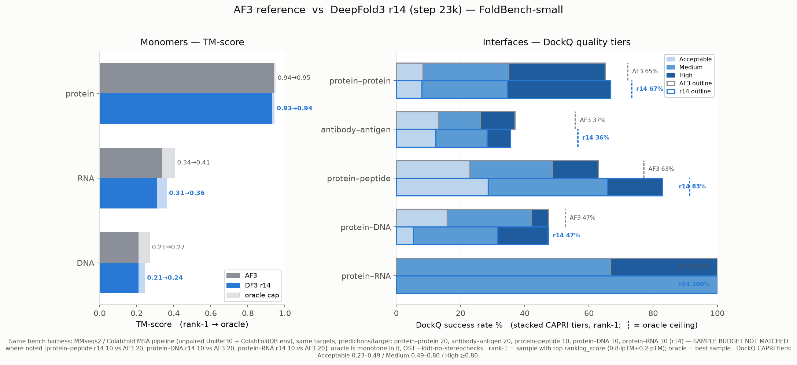
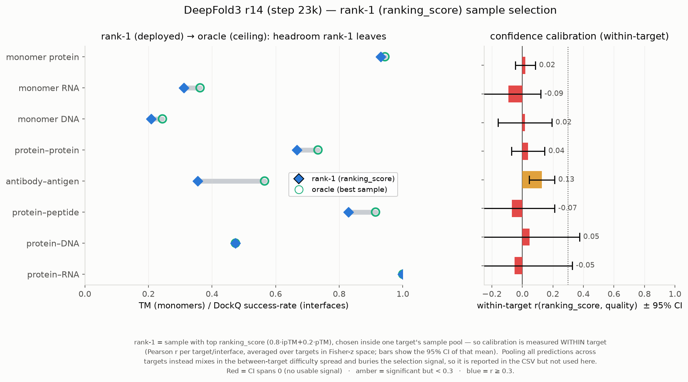
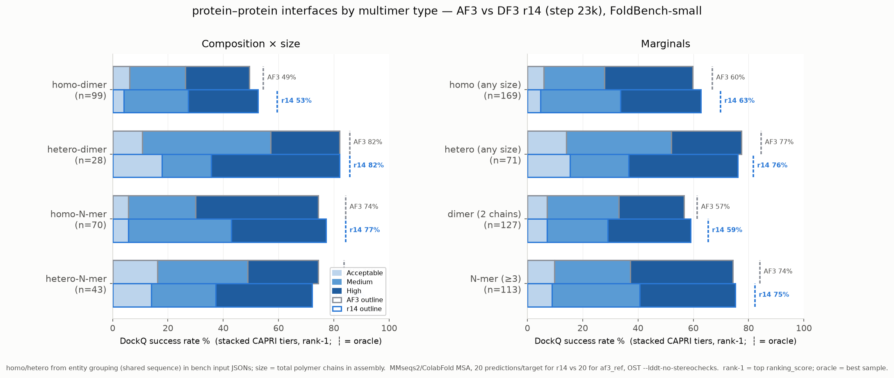
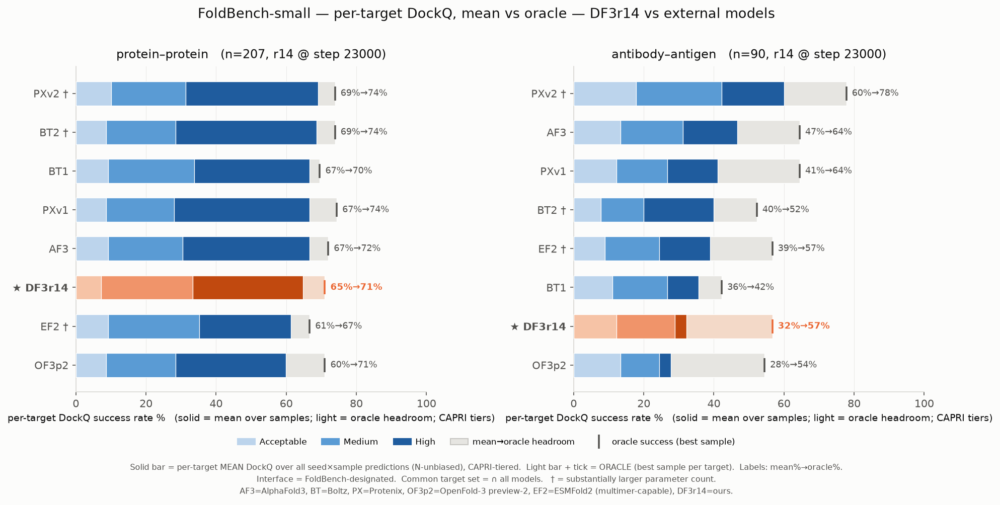
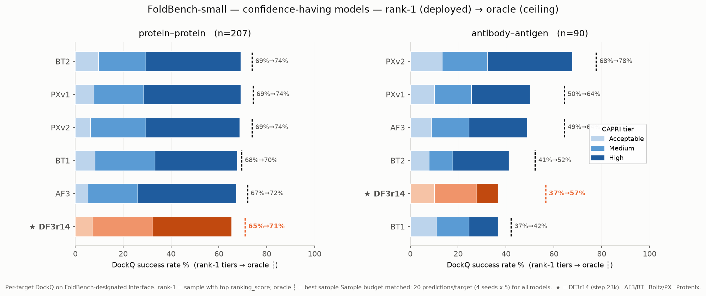
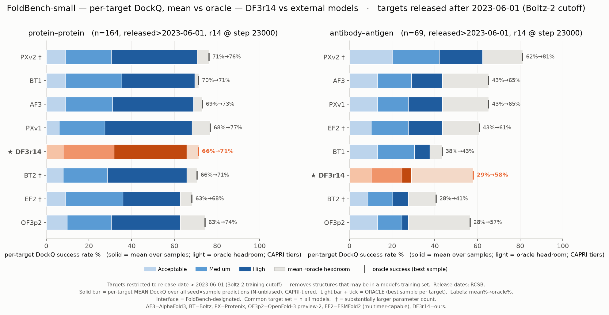
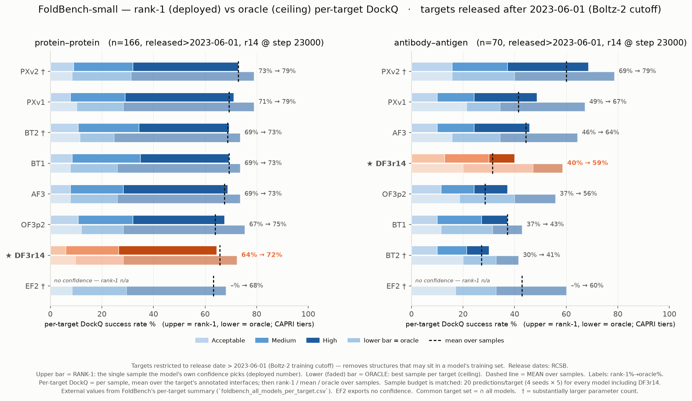

# AF3 reference vs DeepFold3 r14 (step 23k) — FoldBench-small overview

**Date:** 2026-07-27
**Model:** `df3-stage0-r14` (bench series `df3v4r14`), checkpoint step **23,000** — all eight categories.
**Baseline:** `af3_ref` — AlphaFold3 run through the **same** bench harness.
**Figures:** `af3_vs_r14_overview.png`, `confidence_calibration.png`, `foldbench_models_ppi_agab.png` (+`_post2023-06-01`) · **Data:** `overview_data.csv`, `confidence_data.csv`, `foldbench_models_data.csv`, `foldbench_target_dates.csv`
_Every section auto-refreshes to the latest benched r14 step per category: `plot_overview.py`, `plot_confidence.py`, `plot_multimer_breakdown.py`, `plot_foldbench_models.py`, `plot_foldbench_conf.py`, `plot_foldbench_ranked.py` — all take `--step N` to pin. `bench/scripts/auto.sh` runs `update_foldbench.sh` after each interface eval, so the whole report follows the live run. External-model rows are fixed; only r14 moves._

> **Sample budget — corrected.** `af3_ref` and every external model are folded at **4 seeds × 5 =
> 20 samples**. r14 ran at **2 × 5 = 10** until the seed top-up (antibody from 19k, protein–protein
> from 20k), so **every r14 oracle number before that was measured with half the reference's draws
> and is understated** — an earlier version of this report claimed `af3_ref` used 2 seeds and that
> the comparison was N-symmetric; it was not. The two interface categories are now at 20 samples
> and directly comparable; the remaining six are still at 10 and their oracle values remain
> conservative. Set per-category via `SEEDS_<CATEGORY>` in `bench/scripts/auto.sh`.

> ### Which AF3 is the baseline — read this first
>
> Two AF3 numbers appear in this report and they differ by up to 10 points.
>
> | AF3 (same targets, same per-target aggregation) | ppi rank-1 → oracle | agab rank-1 → oracle |
> |---|---|---|
> | **FoldBench official** (AF3's own pipeline) | **67.0 → 72.2** | **48.4 → 64.8** |
> | `af3_ref` (our harness) | 63.2 → 69.9 | 38.5 → 54.9 |
> | delta | −3.8 / −2.3 | **−9.9 / −9.9** |
>
> `af3_ref` is a **handicapped AF3**: the bench input JSONs carry `unpairedMsaPath` /
> `pairedMsaPath` but **no `templates` field at all**, and the MSAs are our MMseqs2/ColabFold
> pipeline rather than AF3's. Antibody loses twice as much as protein–protein, which is what
> template removal predicts — antibody frameworks are densely covered in the PDB.
>
> **DF3r14 folds the same template-free inputs**, so `af3_ref` vs r14 remains a valid
> *same-inputs* control and is the right test of "which model is better given identical
> features". It is **not** a test of "how does r14 compare to AF3 as deployed" — for that,
> use the FoldBench-official rows. **Headline claims in this report follow the FoldBench
> official numbers.** Against them, at step 23k:
>
> | | FoldBench AF3 | DF3r14 @23k | gap |
> |---|---|---|---|
> | ppi rank-1 | 67.0 | 64.6 | −2.4 |
> | ppi oracle | 72.2 | 71.8 | −0.4 |
> | agab rank-1 | 48.4 | 40.7 | −7.7 |
> | agab oracle | 64.8 | 57.1 | −7.7 |
>
> Some of that gap is input-side and applies to r14 too: the template-free harness costs AF3
> 9.9 agab points, and there is no reason to think it costs r14 nothing. Restoring templates to
> the bench inputs is the cleanest way to settle it.

## The 18k–19k protein–protein dip was transient

Recorded because it nearly triggered a data rollback. A dataset change landed at step 17.5k
(`long_monomers` 0.30→0.20, `teddymer` 0.10 added). FoldBench protein–protein stepped down at the
next two checkpoints and then fully recovered:

| PPI, n=240 — **mean** metrics only (N-invariant) | 17k *(pre-change)* | 18k | 19k | **20k** |
|---|---|---|---|---|
| mean iLDDT | 0.5204 | 0.5015 | 0.5017 | **0.5181** |
| mean QS | 0.5133 | 0.5027 | 0.5015 | 0.5111 |
| mean DockQ | 0.4911 | 0.4797 | 0.4812 | **0.4945** |
| mean lDDT | 0.7710 | 0.7615 | 0.7617 | 0.7697 |

*Only `mean` is shown because 20k is folded at 20 samples and 17–19k at 10; `mean` is unbiased in
sample count, `oracle` is not. The recovery held: mean iLDDT reads 0.5288 / 0.5233 / 0.5269 at
21k / 22k / 23k, all above the 0.5204 pre-change value.*

Two lessons. **(1)** A 240-interface benchmark can hold a −0.019 excursion for two consecutive
checkpoints with no underlying cause — do not attribute a dataset change on two points. **(2)** The
channel that called it correctly was the training-side `eval/itm_true` on the fixed `patchr_eval`
set, which showed no trend break across the change (0.6914 pre → 0.6987 at 19.5–20.5k) while
FoldBench swung. The training-side `train/itm_true` drop over the same window (0.7331 → 0.7023) was
a pure **mixture artifact** — a harder dataset entered the running average — and its underlying
slope actually flipped from −0.0031 to +0.0065 per 1k steps.

---

## Method (why no paper is needed)

`af3_ref` is AlphaFold3 folded through our own bench pipeline, not the published FoldBench leaderboard. Both models share:

- **Targets:** identical FoldBench-small set (n matches exactly per category).
- **MSA:** **MMseqs2 / ColabFold pipeline** (unpaired UniRef30 + ColabFoldDB env), same inputs for both.
- **Sampling:** `af3_ref` folds **4 seeds (42–45) × 5 samples = 20 predictions/target** in every category. r14 matches this on the two interface categories (protein–protein from 20k, antibody–antigen from 19k); the other six are still at 2 seeds = 10, so their `oracle` is measured against a 20-sample AF3 and is conservative. `mean` and `rank-1` are not materially affected. Figures state the live budget, read from the raw CSVs — do not assume it from this line.
- **Eval:** `eval_ost.py` → OST `compare-structures`, identical `STRUCT_FLAGS` incl. `--lddt-no-stereochecks`.

Because the harness is shared, protocol differences cancel and af3_ref vs r14 is a **controlled same-inputs head-to-head** — the right test of model quality at fixed features. It is **not** the right answer to "how close is r14 to AF3 as deployed": our inputs carry no templates, which costs AF3 3.8 ppi and 9.9 agab points against its own published fold (see the baseline box above). Headline claims use the **FoldBench official** rows.

**Selection definitions.** `rank-1` = the sample with the highest `ranking_score` (0.8·ipTM + 0.2·pTM) — the *deployed* number. `oracle` = the best sample by the metric itself — the best-of-N *ceiling* (N = the category's sample budget above; oracle is monotone in N, so it is only comparable at equal N). `DockQ` CAPRI tiers: Acceptable 0.23–0.49 / Medium 0.49–0.80 / High ≥0.80; success = DockQ ≥ 0.23.

---

## Overview — step 23k *(same-inputs control vs `af3_ref`)*

| category | n | metric | AF3 (rank-1→oracle) | r14 @23k (rank-1→oracle) | r14 @20k |
|---|---|---|---|---|---|
| monomer protein | 333 | TM | 0.940 → 0.949 | 0.931 → 0.944 | 0.932 → 0.944 |
| monomer RNA | 15 | TM | 0.337 → 0.406 | 0.311 → 0.362 | 0.278 → 0.335 |
| monomer DNA | 14 | TM | 0.210 → 0.271 | 0.209 → 0.244 | 0.201 → 0.236 |
| protein–protein ‡ | 240 | DockQ succ% | 65.0 → 72.1 | **66.7 → 73.3** | 66.7 → 73.8 |
| antibody–antigen ‡ | 138 | DockQ succ% | 37.0 → 55.8 | **35.5 → 56.5** | 28.3 → 50.7 |
| protein–peptide | 35 | DockQ succ% | 62.9 → 77.1 | **82.9 → 91.4** | 74.3 → 94.3 |
| protein–DNA | 19 | DockQ succ% | 47.4 → 52.6 | 47.4 → 47.4 | 50.0 → 60.0 |
| protein–RNA | 5 | DockQ succ% | 100 → 100 | 100 → 100 | 100 → 100 |

*‡ 20 samples (4 seeds), matching AF3. The other six rows are 10 samples against a 20-sample AF3, so their oracle is conservative.*

**Reading it:**
- **Antibody–antigen has essentially closed.** rank-1 **35.5 vs 37.0** (was 28.3 vs 37.0 at 20k — a 8.7-pt gap in three checkpoints) and oracle **56.5 vs 55.8, i.e. r14 is ahead**. This is now the fastest-moving category by a wide margin and the AF3 gap is 2 interfaces.
- **protein–protein holds its lead at matched budget** — rank-1 66.7 vs 65.0, oracle 73.3 vs 72.1, High tier 32.1 vs 30.0. Still an aggregate lead rather than a sweep: 26 of 240 interfaces judged differently, 15 to r14 and 11 to AF3 (sign test p = 0.557). On post-2023-06-01 targets AF3 edges back (67.9 vs 66.8, p = 0.815) — both readings are inside noise.
- **Monomer protein is flat and saturated** — 0.9312 vs 0.9298 at 19k; four checkpoints have moved TM by +0.0014. The remaining 0.0085 to AF3 is not closing at stage-0.
- **Monomer RNA is the one nucleic gainer** — TM 0.287 (19k) → 0.311, oracle 0.339 → 0.362. Still 0.026 behind AF3 with the RNA MSA pipeline absent.
- **Peptide is a clear win** — 82.9 vs 62.9 rank-1, 91.4 vs 77.1 oracle.
- **protein–DNA regressed at 23k** — 50.0 → 47.4 rank-1 and oracle 60.0 → 47.4 (oracle now equals rank-1, i.e. no sample beat the selected one). n=19, so this is 1–2 targets; do not read a trend.

**Caveat on protein–DNA:** r14 scored 19 interfaces here and 20 at 20k; that row's n moves between checkpoints, so its step-to-step deltas are the least reliable in the table.

---

## Confidence (ranking_score) calibration — step 23k

The confidence head **is** trained at stage-0 (`alpha_confidence=1e-4`, `alpha_pae=1.0` — pLDDT *and* PAE/ipTM), but the effective weight is tiny (product `1e-4`).

> **Measurement corrected: calibration must be measured *within* target.** `rank-1` picks one sample
> out of a single target's pool, so the only correlation that governs it is computed inside each
> target and averaged (Fisher-z). Every earlier version of this report used a **pooled** r over all
> predictions, which is dominated by the between-target difficulty spread — hard targets get both
> low pLDDT and low quality — and therefore reports "calibration" that the selector cannot use.
> The two disagree wildly, and **the pooled number was wrong in both directions**.

| category | step | mean | rank-1 | oracle | **within-target r** [95% CI] | pooled r *(old)* |
|---|---|---|---|---|---|---|
| monomer protein (TM) | 23k | 0.931 | 0.931 | 0.944 | 0.020 ✗ [−0.045, +0.085] | 0.706 |
| monomer RNA (TM) | 23k | 0.312 | 0.311 | 0.362 | −0.091 ✗ [−0.294, +0.120] | −0.063 |
| monomer DNA (TM) | 23k | 0.213 | 0.209 | 0.244 | 0.017 ✗ [−0.159, +0.192] | 0.492 |
| protein–protein (succ%) | 23k | 66.2 | 66.7 | 73.3 | 0.038 ✗ [−0.071, +0.146] | 0.055 |
| **antibody–antigen (succ%)** | 23k | 29.7 | **35.5** | 56.5 | **0.128 ✓ [+0.044, +0.211]** | 0.056 |
| protein–peptide (succ%) | 23k | 74.3 | 82.9 | 91.4 | −0.068 ✗ [−0.336, +0.210] | 0.679 |
| protein–DNA (succ%) | 23k | 47.4 | 47.4 | 47.4 | 0.046 ✗ [−0.292, +0.374] | −0.067 |
| protein–RNA (succ%, n=5) | 23k | 100 | 100 | 100 | −0.051 ✗ [−0.414, +0.326] | 0.886 |

**The confidence head does nothing for sample selection anywhere except antibody–antigen.**
Seven of eight categories have a CI spanning zero. The apparent monomer-protein (0.71), peptide
(0.68) and protein–RNA (0.89) calibration was entirely between-target difficulty: within a target,
`ranking_score` cannot tell a good sample from a bad one.

The rank-1-minus-mean gap confirms it — within-target r predicts it, pooled r does not:

| category | n targets | within r | rank-1 − mean | pooled r |
|---|---|---|---|---|
| antibody–antigen | 138 | **+0.128** | **+5.8 pts** | 0.056 |
| protein–protein | 237 | +0.038 | +0.4 pts | 0.055 |
| monomer protein | 319 | +0.020 | **0.000 TM** | **0.706** |
| protein–peptide | 35 | −0.068 | +8.6 pts | **0.679** |

**Monomer protein is the cleanest case**: pooled r = 0.71 would predict strong selection, and over
319 targets rank-1 lands on mean to three decimals (0.931 vs 0.931). The pooled statistic is
measuring difficulty ranking, not sample ranking.

Peptide is the counter-example and is worth stating plainly: within r = −0.068 yet rank-1 sits 8.6
pts *above* mean. On n=35 that gap is 3 targets and the within-target CI is [−0.34, +0.21] — far too
wide to constrain it. It also flipped sign since 20k (rank-1 was 2.8 pts *below* mean there). Small-n
categories tell you nothing either way; only antibody, protein–protein and monomer protein have the
target count to support a claim.

**Antibody is the one place confidence switched on, and it did so at ~21k:**

| step | within-target r | 95% CI | rank-1 | mean |
|---|---|---|---|---|
| 19k | +0.025 | [−0.039, +0.089] | 26.8 | 26.8 |
| 20k | +0.096 | [−0.025, +0.214] | 28.3 | 26.8 |
| **21k** | **+0.234** | [+0.115, +0.347] | 32.6 | 29.0 |
| **22k** | **+0.233** | [+0.116, +0.343] | 34.8 | 28.3 |
| **23k** | **+0.128** | [+0.044, +0.211] | 35.5 | 29.7 |

Three consecutive checkpoints with a CI clear of zero — unlike the single-checkpoint blip at 14k
that vanished at 19k. The magnitude is unstable (0.23 → 0.13), so trust the sign, not the value.
Protein–protein shows no such pattern (0.073 / 0.053 / 0.196 / 0.103 / 0.040 over the same steps —
bouncing across zero).

**A doubled sample pool is worth +7 pts of oracle on antibody, and nothing at rank-1.** Going 10 → 20 samples moved oracle **40.6 → 47.8** while rank-1 went **27.5 → 26.8** (both at 19k). The extra draws contain substantially better structures and the ranking head could not find them. This also refutes a per-target iid model of the oracle curve: extrapolating from the 10-sample data predicted only +1.3, because targets with 0/10 successes get p̂ = 0 and are frozen as permanently unsolvable — exactly the population the new seeds cracked. **Do not extrapolate oracle-vs-N without a prior on p; measure it.**

**Implication, now much stronger:** a dedicated confidence stage — AF3-style finetune-3 (freeze trunk, `train_confidence_only=true`, raise `alpha_confidence`) — is the single highest-value next move. At stage-0's `1e-4` the head has learned to rank *targets* by difficulty and, outside antibody, has learned nothing about ranking *samples*. Antibody alone leaves **21 pts** (35.5 → 56.5) on the table, and protein–protein another 6.6.

---

## Multimer decomposition (protein–protein, 240 interfaces)

Each scored interface classified by **composition** (homo = both chains share sequence / hetero = different entities, from the bench input JSON entity grouping) × **assembly size** (dimer = 2 chains / N-mer = ≥3 chains).

Both models at **20 samples** (4 seeds × 5).

| bucket | n | AF3 rank-1→oracle | r14 @23k rank-1→oracle | r14 @20k | r14 @12k *(N=10)* |
|---|---|---|---|---|---|
| homo-dimer | 99 | 49 → 55 | **53 → 60** | 53 → 58 | 52 → 59 |
| hetero-dimer | 28 | 82 → 86 | 82 → 86 | 79 → 86 | 75 → 82 |
| homo-N-mer | 70 | 74 → 84 | **77 → 84** | 73 → 84 | 73 → 74 |
| hetero-N-mer | 43 | 74 → 84 | 72 → 79 | 81 → 86 | 56 → 63 |
| — homo (any) | 169 | 60 → 67 | **63 → 70** | 61 → 69 | 60 → 65 |
| — hetero (any) | 71 | 77 → 85 | 76 → 82 | 80 → 86 | 63 → 70 |
| — dimer | 127 | 57 → 61 | **59 → 65** | 58 → 64 | 57 → 64 |
| — N-mer (≥3) | 113 | 74 → 84 | **75 → 82** | 76 → 85 | 66 → 70 |

**Homo is now the strength and hetero the residual.** r14 leads AF3 on both homo buckets (homo-dimer 53 vs 49, homo-N-mer 77 vs 74) and trails on hetero-N-mer (72 vs 74). Aggregate rank-1 is 66.7 vs 65.0 with 26 discordant interfaces split 15 to r14 / 11 to AF3 (p = 0.557).

**These buckets swing by several points per checkpoint — do not read them as trends.** hetero-N-mer alone went 72 (19k) → 74 (20k) → **81** (20k, after the seed top-up) → 72 (23k); on n=43 that is ±4 targets. homo-dimer has been 49/53/53. This report has twice built a narrative on a single checkpoint's bucket table ("three of four buckets match exactly" at 19k, "hetero-N-mer clearly ahead" at 20k) and both were overturned by the next point. Use the aggregate and the discordance count; treat buckets as descriptive only.

The one durable statement across 12k→23k is that **the hetero-assembly collapse is over**: hetero-N-mer 56 → 72 and hetero-any 63 → 76, both now within a few points of AF3, where at 12k they were 18 and 14 points behind.

### Restricted to recent targets

Both models are effectively contamination-free here: AF3's cutoff is 2021-09-30 and r14's PDB source (`patchr`) uses the same, and **only 1 of 240 targets predates it** — so no date filter is needed to make the head-to-head fair. Cutting at 2023-06-01 selects a newer, harder subset rather than removing memorized targets.

| set | n | AF3 | r14 @23k | AF3-only | r14-only | sign test |
|---|---|---|---|---|---|---|
| all | 240 | 65.0% | **66.7%** | 11 | 15 | p = 0.557 |
| **released > 2023-06-01** | 196 | **67.9%** | 66.8% | 10 | 8 | p = 0.815 |

Per bucket on the 2023-06-01 subset: homo-dimer 49.3 vs 48.0 *(r14 ahead)*, hetero-dimer 83.3 vs 83.3, homo-N-mer 79.3 vs 79.3, **hetero-N-mer 71.8 vs 79.5**. So the recent-target picture is a tie everywhere except hetero-N-mer, where r14 is 3 targets behind. Neither the full-set lead nor the post-cutoff deficit is statistically supported (p = 0.56 and p = 0.82). **Report protein–protein as at parity with AF3.**

## vs external models (FoldBench, same targets)

External FoldBench results (provided): AF3, Boltz-1/2 (BT1/BT2), Protenix v1/v2 (PXv1/PXv2), OpenFold-3 preview-2 (OF3p2), ESMFold2 (EF2). Metric = **per-target DockQ on the FoldBench-designated interface**, CAPRI-tiered. Two aggregates are shown for every model:

- **mean** (solid bar) = average over all seed×sample predictions — N-unbiased, so it is the safe comparison whatever the sample budget.
- **oracle** (light headroom + tick) = best sample per target — the generation *ceiling*. Oracle needs **no confidence** (best by the metric itself), so it is available for **all 8 models**.

`rank-1` (deployed) is a *third* aggregate that **does** need `ranking_score`; OF3p2 & EF2 export none (verified all-zero, uniform across seeds), so rank-1 is a separate 6-model panel below. Common set = FoldBench-small ∩ successfully-scored across all 8 models (**207 ppi / 90 agab**). This comparison **auto-refreshes per checkpoint** (`plot_foldbench_models.py`, hooked in `auto.sh`); numbers below are the latest benched step (**23k**). Only DF3r14 moves step-to-step (±1–2 pt eval noise); external rows are fixed — treat the CSVs/plots as authoritative.

| model | ppi mean→oracle (A/M/H) | agab mean→oracle (A/M/H) |
|---|---|---|
| PXv2 † | 69→74 (10/21/38) | 60→78 (18/24/18) |
| BT2 † | 69→74 (9/20/40) | 40→52 (8/12/20) |
| BT1 | 67→70 (9/25/33) | 36→42 (11/16/9) |
| PXv1 | 67→74 (9/19/39) | 41→64 (12/14/14) |
| AF3 | 67→72 (9/21/36) | 47→64 (13/18/16) |
| **DF3r14** | **61→67 (7/25/29)** | **24→41 (10/12/2)** |
| EF2 † | 61→67 (9/26/26) | 39→57 (9/16/14) |
| OF3p2 | 60→71 (9/20/31) | 28→54 (13/11/3) |

(† = substantially larger parameter count. A/M/H = mean-tier composition.)

**Reading it:**
- **On mean, DF3r14 sits mid-pack on ppi and low on agab** — ppi **64.7%**, above EF2 (61.4) and OF3p2 (59.9) and 2 pts under AF3/BT1/PXv1 (66.7); agab **32.2%**, above only OF3p2 (27.8). Its ppi mix stays **Medium-heavy** (M26.1/H31.4 vs 33–40 High for the leaders).
- **Oracle narrows it sharply** — DF3r14 ppi 64.7→71.0, agab 32.2→**56.7**. The mean→oracle headroom (+6.3 ppi, **+24.4** agab) is *ranking-recoverable*, not a ceiling. On agab that oracle now beats every model except PXv2 (77.8) and ties EF2 — above AF3's own mean and above BT2's oracle (52.2).
- **OF3p2's mean understates it** — mean 60/28 (last-ish) but **oracle 71/54**, the largest headroom of any model (+11 ppi, +27 agab). OF3p2 exports no `ranking_score`, so its low mean is per-sample **variance**, not a capability ceiling — its oracle is ppi-SOTA-tied.
- **Antibody is high-variance for everyone** (+12 to +27 oracle gains) — a large share of agab "failure" is a sampling/ranking problem. PXv2 is the exception that leads at *both* ends (60→78).

### Confidence-having models (rank-1 → oracle)

rank-1 needs `ranking_score`, so this panel is the 6 models that export it (OF3p2/EF2 excluded — all-zero). 

| model | ppi rank-1→oracle | agab rank-1→oracle |
|---|---|---|
| BT2 | 69.1 → 73.9 | 41.1 → 52.2 |
| PXv1 | 69.1 → 74.4 | 50.0 → 64.4 |
| PXv2 | 68.6 → 73.9 | **67.8 → 77.8** |
| BT1 | 67.6 → 69.6 | 36.7 → 42.2 |
| AF3 | 67.1 → 72.0 | 48.9 → 64.4 |
| **DF3r14 @23k** ‡ | **65.2 → 71.0** | **36.7 → 56.7** |

On the common set (207 ppi / 90 agab), DF3r14 lands ppi **65.2→71.0** — 2 to 4 pts off the 67.6–69.1 rank-1 pack and 1.4 pts off BT1's oracle. agab is **36.7→56.7**: rank-1 now **ties BT1** (36.7) rather than trailing everyone, and the **oracle (56.7) is fourth of six, above BT2 (52.2) and BT1 (42.2)**. So at equal sample budget r14 generates better antibody poses than both Boltz models and ranks them worse. The rank-1→oracle gap is large for everyone here (AF3 48.9→64.4, PXv1 50.0→64.4), but at **+20.0** r14's is still the widest.

Note this common-set ppi number (65.2) is below the af3_ref-harness number in the Overview (66.7): the external comparison intersects to the 207 targets scored by all 8 models, dropping 33 of the 240.

### Training-cutoff control — targets released after 2023-06-01 (Boltz-2 cutoff)

Boltz-2's training cutoff is 2023-06-01. Restricting to targets **released after** it (per-target release dates from RCSB, saved in `foldbench_target_dates.csv`; re-runnable via `plot_foldbench_models.py --after 2023-06-01`) removes structures that may sit in a model's training set. This drops the common set to **164 ppi / 69 agab** and exposes a **Boltz-2-specific memorization signature**.

Mean success%, pre-cutoff (≤2023-06-01) vs post-cutoff (>), same common set:

| model | ppi pre→post | agab pre→post |
|---|---|---|
| PXv2 | 62→71 | 52→62 |
| AF3 | 57→69 | 57→44 |
| BT1 | 55→70 | 29→38 |
| PXv1 | 60→68 | 33→44 |
| **BT2** | **79→66** | **81→28** |
| EF2 | 55→63 | 24→44 |
| OF3p2 | 48→63 | 29→28 |
| **DF3r14** | 57→63 | 24→25 |

*(pre-cutoff n=42 ppi / 21 agab — small, but the BT2 effect is enormous.)*

- **BT2 is the only model that scores *higher* on pre-cutoff data** — 79% ppi / **81% agab** pre-cutoff (the best of *any* model on pre-cutoff antibody) vs 66% / **28%** post-cutoff. The **−53-pt antibody drop** is a textbook train-set-overlap signature; every other model is flat-or-better post-cutoff.
- **BT2's full-set edge over DF3r14 vanishes on held-out targets:** ppi **65.9 vs 65.9 — an exact tie**, and on agab BT2 falls *below* r14 (27.5 vs 29.0). See the correction below for the ppi half under the authoritative source.
- **PXv2 is the robust SOTA** — it *improves* post-cutoff (ppi 71, agab 62), so its lead is generalization, not memorization.
- **DF3r14 is the most stable across the cut** (ppi 64.7→65.9, agab 32.2→29.0): its full-set numbers are already contamination-free.

### Same control at rank-1 (deployed) vs oracle

The bars above are **mean** DockQ from our own tarball parse. FoldBench also publishes a per-target
summary (`foldbench_all_models_per_target.csv`) carrying `ranked_dockq` — including **a ranking for
OpenFold3-p2**, which the tarball did not expose — so the deployed number is available for 7 of 8
models. That source also pools **all** annotated interfaces on multi-interface targets (25/239 ppi,
55/113 agab), where our parse kept only one. Rebuilt on it, with DF3r14 aggregated the same way:

| model | ppi rank-1 (full → post) | agab rank-1 (full → post) | agab oracle (full → post) |
|---|---|---|---|
| PXv2 † | 71.3 → 72.9 | 67.0 → 68.6 | 75.8 → 78.6 |
| PXv1 | 69.9 → 71.1 | 48.4 → 48.6 | 65.9 → 67.1 |
| BT2 † | 70.3 → 69.3 | **41.8 → 30.0** | 52.7 → 41.4 |
| BT1 | 67.0 → 69.3 | 37.4 → 37.1 | 42.9 → 42.9 |
| AF3 | 67.0 → 68.7 | 48.4 → 45.7 | 64.8 → 64.3 |
| OF3p2 | 66.0 → 67.5 | 36.3 → 37.1 | 53.8 → 55.7 |
| **DF3r14 @23k** ‡ | **64.6 → 64.5** | **40.7 → 40.0** | **57.1 → 58.6** |
| EF2 † | no confidence | no confidence | 54.9 → 60.0 |

**Ranking on antibody, full set → post-cutoff:** DF3r14 is **5th of 7 on the full set** (40.7, past BT1 37.4 and OF3p2 36.3, 1.1 behind BT2) and **4th post-cutoff** (40.0, ahead of BT1/OF3p2 at 37.1 and BT2 at 30.0). The rank change between the two cuts is BT2 alone — it drops from 4th to 7th. At 20k the same two cuts put r14 7th and 6th, so three checkpoints moved it two places on both.

**Two corrections to the mean-based reading above:**

1. **The ppi claim does not hold.** On the authoritative source BT2's post-cutoff ppi is **69.3 rank-1 / 68.7 mean**, not 65.9 — so the gap to DF3r14 is **4.8 pts**, not a tie. Our tarball parse understates BT2 on ppi.
2. **The antibody claim holds and inverts.** BT2 collapses **41.8 → 30.0** across the cut while DF3r14 holds at **40.0** — so on held-out antibody DF3r14 is **10 pts ahead of Boltz-2 at rank-1** and 17 pts ahead at oracle (58.6 vs 41.4), having been 1.1 behind on the full set. This has now held at 19k, 20k and 23k.

‡ Both DF3r14 interface categories are at FoldBench's full 4 seeds (agab from 19k, ppi from 20k), so **every model in this table folds 20 predictions per target** and the oracle column is like-for-like. That top-up is why the DF3r14 agab oracle sits far above its old 10-sample value (38.5 at 19k), and why ppi oracle moved 68.1 → 71.3 on an unchanged checkpoint.

**New from OF3p2's ranking:** its mean badly understates it (28.6 agab) but rank-1 is **36.3** and oracle **53.8** — the largest mean→rank-1 jump of any model, so its low mean is sample variance that its own confidence already recovers. It is the closest external model to DF3r14 on antibody at rank-1 (36.3 vs 30.8).

## Verdict

Measured against the **FoldBench official** numbers (AF3's own pipeline; headline reference — see the baseline box), at stage-0 step 23k:

| | PXv2 | AF3 | BT2 | BT1 | OF3p2 | **DF3r14 @23k** |
|---|---|---|---|---|---|---|
| ppi rank-1 | 71.3 | 67.0 | 70.3 | 67.0 | 66.0 | **64.6** |
| ppi oracle | 78.0 | 72.2 | 76.6 | 71.3 | 72.7 | **71.8** |
| agab rank-1 | 67.0 | 48.4 | 41.8 | 37.4 | 36.3 | **40.7** |
| agab oracle | 75.8 | 64.8 | 52.7 | 42.9 | 53.8 | **57.1** |

**Where r14 stands.** On protein–protein it is last of the seven ranked models at rank-1 (64.6, 2.4 behind AF3) but its **oracle is level with AF3 and BT1** (71.8 vs 72.2 / 71.3) — the generation is competitive and the ranking is not. On antibody it is **5th at rank-1** (40.7, past BT1 and OF3p2, 1.1 behind BT2) and **4th at oracle** (57.1, ahead of BT2's 52.7 and OF3p2's 53.8, behind only PXv2/PXv1/AF3). Post-cutoff it moves to 4th on antibody as Boltz-2 collapses 41.8 → 30.0.

**The trajectory is steep on antibody and flat on monomers.** agab rank-1 went 28.3 → 35.5 on our harness over 20k→23k against a fixed reference, while monomer-protein bench TM moved +0.0014 across four checkpoints and `eval/tm_true` has a slope indistinguishable from zero (t = +1.0) against `eval/itm_true` at t = +2.1. Stage-0 at crop 512 looks folding-saturated and interface-limited.

**Two gaps, and they are different in kind.**

1. **Ranking.** Measured *within target* — the only statistic that governs rank-1 selection — the confidence head has a CI clear of zero in **one of eight categories** (antibody, from 21k). Everywhere else it is indistinguishable from random sample choice; the monomer/peptide "calibration" in earlier versions of this report was a pooled-statistic artifact. Recoverable by ranking alone: **16.4 pts on antibody** (40.7 → 57.1) and **7.2 on protein–protein** (64.6 → 71.8) on the common set. This is the clearest available win — an AF3-style finetune-3 (freeze trunk, `train_confidence_only=true`, raise `alpha_confidence` from `1e-4`).
2. **Inputs.** The bench harness folds **without templates**, which costs AF3 3.8 ppi and **9.9 agab** points against its own published fold. r14 pays the same toll and no one has measured how much. Adding templates to `bench/inputs/` is cheap and would remove the largest uncontrolled term in every comparison here.

**RNA** stays MSA-pipeline-blocked rather than model-blocked (monomer RNA TM 0.311 vs 0.337).

For the same-inputs control (`af3_ref`, template-free, identical MSAs) r14 is at or ahead of AF3 on protein–protein (rank-1 66.7 vs 65.0, oracle 73.3 vs 72.1) and level on antibody oracle (56.5 vs 55.8). That is a real result about model quality at fixed features — it is not a claim of parity with deployed AF3.

**PXv2 remains the robust SOTA** at both ends and improves post-cutoff, so its lead is generalization rather than memorization.

## Caveats

- lDDT here is `--lddt-no-stereochecks` → not comparable to the published FoldBench lDDT (DockQ/TM/GDT are Cα-superposition, unaffected).
- All eight categories are r14 **step 23k**. Every script auto-detects the latest benched step per category (`--step N` to pin); when they diverge the figures carry the per-category step. protein–RNA n=5 and monomer RNA/DNA n=15/14 and protein–DNA n=19 — too small to conclude from alone.
- **Per-bucket multimer numbers are noisy at these n.** hetero-N-mer has read 72 / 74 / 81 / 72 across 19k–23k (n=43, so ±4 targets) and hetero-dimer 82 / 79 / 82 (n=28). Read the bucket table as a single-checkpoint decomposition, never a trend; the aggregate and the discordance count are the reliable statistics.
- **‡ Sample-count asymmetry.** From 19k, antibody–antigen is folded at 4 seeds × 5 = 20 samples (FoldBench parity); all other categories remain at 2 × 5 = 10. Antibody `oracle` therefore steps up by ~+7 pts at 19k for reasons unrelated to the checkpoint, and antibody oracle must not be compared to steps ≤18k or to other categories. `mean` and `rank-1` are N-insensitive here (measured: rank-1 27.5 → 26.8 across the doubling) and stay comparable. Steps ≤18k can be brought onto the same footing with `run_sweep.py --category interface_antibody_antigen --steps N --seed 44,45` (skip-existing is keyed on (target, seed), so it is purely additive) followed by `eval_ost.py`/`summarize.py`.
- Running `eval_ost.py` outside `auto.sh` needs the same environment auto.sh exports: `OST_CMD="$HOME/.conda/envs/foldbench/bin/ost compare-structures"` (this host has no `apptainer`, which is the script's default) and `PATH="$HOME/.local/fastbin:$PATH"` (the `lscpu` shim). Without the first, every OST subprocess raises `FileNotFoundError` and no raw CSV is written.
- protein–DNA is the one non-common row: r14 scored 20 interfaces at 19k vs af3_ref's 19.
- r14 eval uses the `shadow` (EMA) snapshot (bench `--snapshot auto`); af3_ref is the fixed release weights.
- Scripts: `plot_overview.py`, `plot_confidence.py`, `plot_multimer_breakdown.py`, `plot_foldbench_models.py` (rerun from repo root; `--after YYYY-MM-DD` for the cutoff control, `--step N` to pin). Data: `overview_data.csv`, `confidence_data.csv`, `multimer_breakdown_data.csv`, `foldbench_models_data.csv`, `foldbench_models_data_post2023-06-01.csv`, `foldbench_target_dates.csv` (per-target RCSB release dates).
- External-model comparison shows **mean and oracle** DockQ (rank-1 only where `ranking_score` exists — OF3p2/EF2 lack it) on the **207 ppi / 90 agab** common set (∩ all 8 models; FoldBench-small — r14 folds ≤1024-tok, so >1024-residue full-FoldBench targets + OST-failed 8i82 are excluded, not a target mismatch). The external comparison tracks the **latest benched r14 step (20k)**, matching the header.
- Training-cutoff control uses per-target **release dates from RCSB** (`initial_release_date`); 1 ppi target undated and dropped from the post-cutoff set. Pre-cutoff n is small (42 ppi / 21 agab) — directional, but the BT2 effect size is large. Cutoff = Boltz-2's; other models' cutoffs differ (AF3 2021-09-30 earlier, so post-2023-06-01 removes nothing memorizable for AF3).
- Multimer classification is protein–protein only; antibody/peptide/NA are separate top-level categories. homo/hetero from input-JSON entity grouping (shared sequence), so chain-letter labels (e.g. 8kbm A/A-2/B/B-2 = one entity) are handled correctly.
